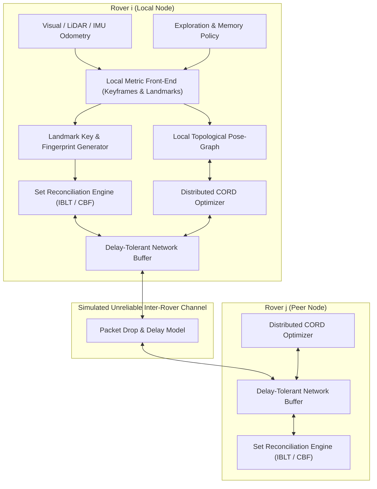

# AstroMesh-X — System Architecture

This document defines the architectural decomposition of the AstroMesh-X system, illustrating the interplay between local rover SLAM frontends, decentralized communication, topological map merging, and distributed pose-graph optimization.

---

## 1. High-Level Architectural Context

AstroMesh-X is designed for an autonomous multi-rover collective operating in GPS-denied environments subject to bandwidth restrictions, latency, and intermittent disconnections.



---

## 2. Core Subsystems & Responsibilities

### 2.1 Landmark Fingerprinting & Versioning
- **Purpose:** Map continuous sensor observations (visual features, descriptor clusters, or point cloud centroids) into compact, deterministic hashes (landmark keys).
- **Versioning:** Includes schema versions and rover origin prefixes to prevent cross-rover hash collisions.

### 2.2 Set Reconciliation: IBLT vs. Counting Bloom Filter (CBF)
- **AstroMesh v1 Baseline:** Counting Bloom Filters (CBF). Rovers exchange bit arrays to check presence. High false-positive rates under saturated filters and limited support for direct set difference extraction.
- **AstroMesh-X:** Invertible Bloom Lookup Table (IBLT). 
  - *Theoretical Operation:* Encodes key-value pairs into a fixed-size table using $k$ hash functions.
  - *Subtraction:* By subtracting table $B$ from table $A$ ($T_{diff} = T_A - T_B$), rovers decode the symmetric difference $(A \setminus B)$ and $(B \setminus A)$.
  - *Constraint:* Does **not** compute intersections directly; only decodes differences if the cardinality of the difference $|A \oplus B| \le m$ (the table's recovery threshold). If the threshold is exceeded, reconciliation fails gracefully and prompts partitioned or hierarchical resolution.

### 2.3 Geometric Verification & Loop Closure Gating
- Candidate pairs identified by set reconciliation must undergo rigorous geometric validation (e.g., relative pose transformation consistency via RANSAC or ICP).
- False candidate matches are discarded prior to modifying topological connectivity or triggering graph optimization.

### 2.4 Topological Graph & Disjoint Set Union (DSU)
- Tracks connected components of the multi-rover swarm's collective map.
- Edges represent:
  - Odometric sequential links (intra-rover).
  - Intra-rover loop closures.
  - Inter-rover loop closures (cross-graph edges).
- DSU enables rapid verification of whether two submaps have merged into a shared coordinate reference frame.

### 2.5 Distributed Optimization: Continuous Riemannian Dynamics (CORD)
- **Methodology:** Implemented based on the published Riemannian optimization framework by Tian et al.
- Formulates pose-graph optimization over the Riemannian manifold of special Euclidean groups ($SE(2)$ / $SE(3)$).
- Avoids central servers: rovers exchange gradient and pose estimates only for boundary nodes (keyframes participating in inter-rover loop closures), iteratively converging toward a global optimal pose estimate.

### 2.6 Delay-Tolerant Network (DTN) & Bounded-Memory Policy
- **DTN Buffer:** Implements priority queues, time-to-live (TTL) expiration, and retry backoff for lossy communications.
- **Memory Bounding:** Prunes redundant keyframes in frequently revisited regions while maintaining topological connectivity.
- **Connectivity-Aware Exploration:** Balances Voronoi frontier exploration with return-to-rendezvous or relay behaviors when communication links are severed beyond specified duration thresholds.

---

## 3. Implementation Decomposition (Target Structure)

```text
include/astromesh/
├── core/
│   ├── types.hpp            # Geometric and graph type aliases
│   ├── landmark_key.hpp     # Deterministic landmark keys & hashing
│   └── dsu.hpp              # Disjoint Set Union for submap components
├── reconciliation/
│   ├── iblt.hpp             # Invertible Bloom Lookup Table engine
│   └── cbf.hpp              # Counting Bloom Filter baseline
├── graph/
│   ├── pose_graph.hpp       # Topological metric pose-graph
│   └── geometric_verifier.hpp# Metric gating of candidate loop closures
├── cord/
│   ├── riemannian_math.hpp  # Lie group & Riemannian manifold operations
│   └── cord_optimizer.hpp   # Distributed continuous dynamics solver
└── comms/
    ├── dtn_buffer.hpp       # Store-and-forward message manager
    └── packet_budget.hpp    # Byte quota tracker and serializer
```

*Note: All header paths above reflect the planned design for subsequent phases. In Phase 0, no stub or fake files are created.*
