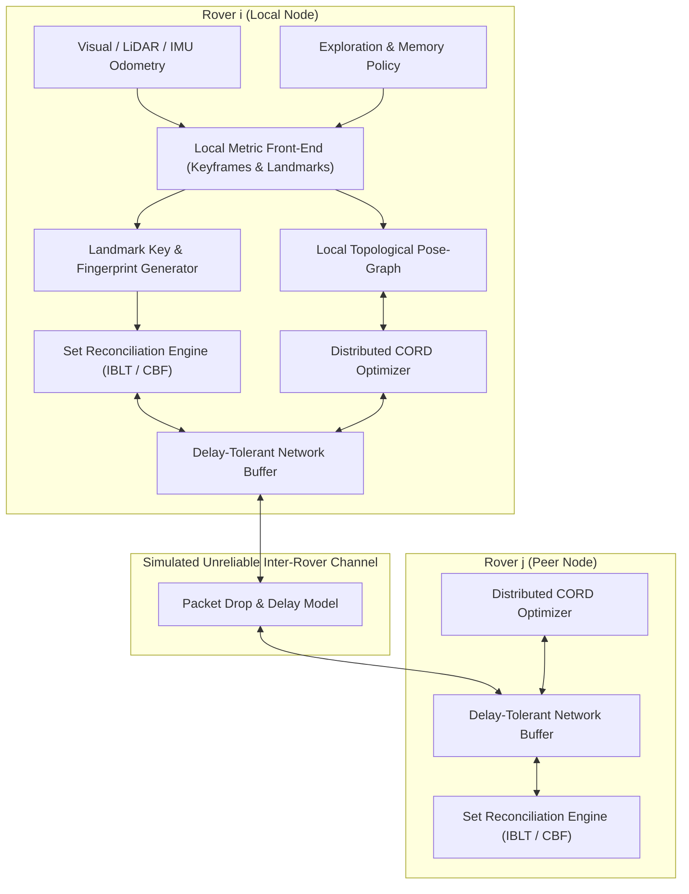

# AstroMesh-X — System Architecture

This document defines the architectural decomposition of the AstroMesh-X system, illustrating the interplay between local rover SLAM frontends, decentralized communication, topological map merging, and distributed pose-graph optimization.

---

## 1. High-Level Architectural Context

AstroMesh-X is designed for an autonomous multi-rover collective operating in GPS-denied environments subject to bandwidth restrictions, latency, and intermittent disconnections.



---

## 2. Core Subsystems & Responsibilities

### 2.1 Landmark Fingerprinting & Versioning
- **Purpose:** Map continuous sensor observations (visual features, descriptor clusters, or point cloud centroids) into compact, deterministic hashes (landmark keys).
- **Versioning:** Includes schema versions and rover origin prefixes to prevent cross-rover hash collisions.

### 2.2 Set Reconciliation: IBLT vs. Counting Bloom Filter (CBF)
- **AstroMesh v1 Baseline:** Counting Bloom Filters (CBF). Rovers exchange bit arrays to check presence. High false-positive rates under saturated filters and limited support for direct set difference extraction.
- **AstroMesh-X:** Invertible Bloom Lookup Table (IBLT). 
  - *Theoretical Operation:* Encodes key-value pairs into a fixed-size table using $k$ hash functions.
  - *Subtraction:* By subtracting table $B$ from table $A$ ($T_{diff} = T_A - T_B$), rovers decode the symmetric difference $(A \setminus B)$ and $(B \setminus A)$.
  - *Constraint:* Does **not** compute intersections directly; only decodes differences if the cardinality of the difference $|A \oplus B| \le m$ (the table's recovery threshold). If the threshold is exceeded, reconciliation fails gracefully and prompts partitioned or hierarchical resolution.

### 2.3 Geometric Verification & Loop Closure Gating
- Candidate pairs identified by set reconciliation must undergo rigorous geometric validation prior to graph modification. Matching `LandmarkKey` identifiers alone does **not** constitute geometric verification.
- **2D Rigid Transform Estimator ($SE(2)$):** Closed-form least-squares Kabsch/Umeyama estimator over centered cross-covariance matrices ($C_1 = \sum (u'_i x'_i + v'_i y'_i)$, $C_2 = \sum (v'_i x'_i - u'_i y'_i)$) solving $\theta = \operatorname{atan2}(C_2, C_1)$ and $t = \bar{p}_{tgt} - R(\theta) \bar{p}_{src}$. Degenerate configurations (coincident points or zero spatial variance) are safely rejected via global variance pre-checks.
- **RANSAC Gating Pipeline:** Deterministic sampling loop generating 2-point minimal hypotheses, computing consensus inliers within configurable metric distance threshold ($d \le d_{thresh}$), and refining the final estimate over all inliers. Gated on minimum correspondences ($N \ge N_{min}$), minimum inliers ($I \ge I_{min}$), and minimum inlier ratio ($I / N \ge r_{min}$).
- **Candidate Prior Consistency Gating:** Validates that refined relative pose estimates are geometrically consistent with candidate prior pose predictions within configurable Euclidean distance ($\|t - t_{prior}\| \le \text{tol}_{trans}$) and rotation angle tolerances ($|\theta \ominus \theta_{prior}| \le \text{tol}_{rot}$). Rejects conflicting loop closures with `VerificationFailureReason::InconsistentWithCandidatePrior`, safeguarding against frame reversal and contradictory proposals.
- **Hardened PoseGraph Gating:** Candidate loop closure edges are held as `EdgeVerificationStatus::Unverified`. `gate_and_promote_loop_closure` strictly enforces:
  - The edge must exist and have valid endpoints in the graph.
  - Odometry edges cannot be gated as loop closures.
  - Only candidate edges in the `Unverified` state can be gated; already `Verified` or `Rejected` edges cannot be re-gated without an explicit workflow reset.
  - Successful geometric verification promotes the edge to `Verified` with the refined relative transform.
  - Unsuccessful verification transitions the edge to `Rejected` and never merges graph components. Invalid configurations fail safely without mutating graph state.

### 2.4 Topological Graph & Disjoint Set Union (DSU)
- **Component Tracking:** `DisjointSet` maintains disjoint connected partitions across the multi-rover collective with amortized $O(\alpha(n))$ time complexity using two-pass path compression and union by rank with size accounting.
- **Connectivity Policy:** `SubgraphPartitionManager` governs edge eligibility:
  - Odometric sequential links merge keyframes of the same rover (unless explicitly `Rejected`).
  - Intra-rover and Inter-rover loop closures merge components **only if** `EdgeVerificationStatus::Verified`.
  - Unverified candidates (from IBLT/CBF matching) and Rejected outliers **never** merge components.
- **Deletion/Rebuild Strategy:** Ordinary DSU is append-only and cannot efficiently split components upon edge/node removal. `SubgraphPartitionManager::rebuild(graph)` provides a clean, guaranteed-consistent rebuild from all eligible edges in $O(V + E \cdot \alpha(V))$ time whenever an edge or node is removed or an edge is rejected.
- **Partition Queries:** Provides deterministic, sorted member retrieval per partition (`get_partition_members`), root-mapped partitions (`get_all_partitions`), component lists sorted by smallest `NodeId` (`get_partitions_list`), and cross-rover connectivity checks (`are_rovers_connected`).

### 2.5 Distributed Optimization: Continuous Riemannian Dynamics (CORD)
- **Methodology:** Implemented based on the published Riemannian optimization framework by Shin, Ghaffari, and Tian (RSS 2026 / arXiv:2605.11210), specialized to planar $\mathrm{SE}(2)$ multi-rover swarms (`docs/CORD_LITERATURE_REVIEW.md`, `docs/CORD_MATHEMATICAL_FORMULATION.md`, `docs/CORD_DISTRIBUTED_DESIGN.md`).
- **Second-Order Riemannian Mechanics:**
  - Treats each pose node $i$ as a kinematic rigid body on $\mathrm{SE}(2)$ with configuration $X_i \in \mathrm{SE}(2)$, body twist velocity $\xi_i = [v_{x,i}, v_{y,i}, \omega_i]^\top \in \mathbb{R}^3$, diagonal inertia tensor $M_i \succ 0$, and diagonal Rayleigh damping tensor $D_i \succ 0$.
  - Continuous equations of motion follow the damped Euler-Poincaré equations:
    $$M_i \dot{\xi}_i = \operatorname{ad}_{\xi_i}^*(M_i \xi_i) - D_i \xi_i - \nabla_{X_i} \mathcal{C}(X), \qquad \dot{X}_i = X_i \xi_i^\wedge$$
  - Total Hamiltonian $\mathcal{H} = \mathcal{K} + \mathcal{C}$ satisfies Lyapunov dissipation $\dot{\mathcal{H}} \le -\lambda_{\min}(D) \|\xi\|_2^2 \le 0$, guaranteeing asymptotic convergence toward critical points of the objective.
- **Semi-Implicit Lie Group Integrator:**
  - Employs a discrete semi-implicit integrator: damping is integrated implicitly to ensure unconditional dissipation stability without matrix solves:
    $$\xi_i^{k+1} = (I + h M_i^{-1} D_i)^{-1} \left[ \xi_i^k + h M_i^{-1} \left( \operatorname{ad}_{\xi_i^k}^*(M_i \xi_i^k) - \nabla_{X_i} \mathcal{C}(X^k) \right) \right]$$
  - Configuration update uses the closed-form $\mathrm{SE}(2)$ exponential map retraction $X_i^{k+1} = X_i^k \exp((h \xi_i^{k+1})^\wedge)$, exactly preserving manifold geometry.
- **Distributed Architecture & Boundary Coupling:**
  - Avoids central servers: rovers exchange 80-byte canonical little-endian `BoundaryStatePacket` structs (with a 64-bit deterministic non-cryptographic FNV-1a/SplitMix64 checksum) exclusively for boundary nodes of verified inter-rover edges (`EdgeVerificationStatus::Verified`).
  - Network delay $\tau$ compensation was evaluated via **Velocity-Extrapolated Neighbor Prediction**: $\widehat{X}_j(t) = X_j(t - \tau) \exp((\tau \xi_j(t - \tau))^\wedge)$ and zero-order hold (ZOH). The M3.6 audit revealed that under stiff information weights and non-negligible delay, unconstrained first-order velocity prediction introduces anti-damping/phase lead.
  - **Phase 4.1 Delay-Tolerant Boundary State Filtering:** Mitigates delay-induced instability via `BoundaryStateFilter`, featuring RFC 1982 sequence check, EMA body-twist smoothing, radial linear norm clamping, angular velocity saturation, quiescent deadbands, prediction-horizon gating ($\tau \le \tau_{\max}$, falling back to safe ZOH), and empirical delay-dependent adaptive damping $D_i(\tau) = D_{\text{base}} \min(\kappa_{\max}, 1 + \alpha_d \tau)$.
  - Tightly coupled with `SubgraphPartitionManager` for per-component gauge anchoring and dynamic component merging.

### 2.6 Delay-Tolerant Network (DTN) & Bounded-Memory Policy
- **DTN Buffer:** `DtnBuffer` implements 3-tier priority queues (`High`, `Normal`, `Low`), monotonic TTL exact-boundary expiration, deterministic `PriorityAging` anti-starvation promotion, saturating exponential retry backoff, bounded duplicate suppression caching, and partition-tolerant message retention.
- **Byte Quota Accounting:** `PacketBudgetManager` enforces sliding-epoch-window byte quotas and per-peer budgets, strictly distinguishing application payload, protocol headers, and transport framing with zero double-counting.
- **Safe Keyframe Pruning (`KeyframePruner`):** Bounds pose-graph growth under configured `max_retained_keyframes`:
  - *Keyframe Selection:* Admits new poses into the graph based on deterministic motion and temporal thresholds ($\Delta d \ge d_{\min}$, $|\Delta \theta| \ge \theta_{\min}$, $\Delta t \ge t_{\min}$).
  - *Protected-Node Invariants:* Strictly protects gauge anchors, exploration frontier keyframes, endpoints of active `Verified` loop closures, endpoints of active inter-rover constraints, and Tarjan articulation points.
  - *Tarjan Articulation Detection:* Computes cut-vertices over eligible active connectivity edges (`Odometry` and `Verified` loop closures; `Unverified` and `Rejected` edges excluded).
  - *Spatial Redundancy Ranking:* Sorts unprotected candidate nodes by spatial proximity to neighboring keyframes, with deterministic tie-breaking by `NodeId`.
  - *Atomic Mutation & DSU Rebuild:* Deletes candidate node and incident edges atomically via `PoseGraph::remove_node`, followed by immediate invocation of `SubgraphPartitionManager::rebuild(graph)` to keep DSU component indices synchronized.
  - *Factor-Removal Ablation Protocol:* Factor deletion without Schur-complement marginalization is explicitly evaluated as a factor-removal ablation rather than information-preserving sparsification.
- **Connectivity-Aware Exploration:** Balances Voronoi frontier exploration with return-to-rendezvous or relay behaviors when communication links are severed beyond specified duration thresholds.

### 2.7 Multi-Rover Swarm Simulation & Pipeline Interfaces (Phase 5)
- **Shared Pipeline Contract (`IRoverSwarmPipeline`):** Pure abstract interface decoupling simulation harnesses from concrete swarm algorithms. Provides unified methods:
  - `initialize(config)`: Validates configuration and resets pipeline state.
  - `step(input)`: Ingests ground-truth-isolated observations and odometry, executes inter-rover communication, performs candidate discovery and geometric verification, updates graph topology, and advances simulation clock.
  - `optimize()`: Runs distributed or centralized graph optimization where supported (`false` on baseline, `true` on AstroMesh-X).
  - `get_metrics()`, `get_connected_components()`, `get_estimated_pose()`, `get_estimated_trajectory()`: Provide uniform telemetry and state inspection.
- **AstroMesh v1 Baseline Pipeline (`BaselineAstroMeshV1`):**
  - Discovery: Counting Bloom Filter (CBF) bit-array broadcast.
  - Verification: Kabsch/Umeyama closed-form RANSAC (`verify_relative_pose_2d`).
  - Optimization: Open-loop dead-reckoning trajectory integration (no graph optimization).
  - Comms: One-hop best-effort broadcast, zero retransmissions.
- **AstroMesh-X Pipeline (`AstroMeshXPipeline`):**
  - Discovery & Reconciliation: Compact 32-cell (1024-byte) IBLT table exchange for set difference reconciliation ($A \triangle B$).
  - Verification & Gating: Kabsch/Umeyama RANSAC with spatial variance pre-checks and candidate prior pose gating.
  - Optimization: Continuous Riemannian Dynamics (CORD) on Lie group $\mathrm{SE}(2)$ with semi-implicit damping and gauge anchoring.
  - Comms: DTN store-carry-forward buffering (`DtnBuffer`), 24-byte explicit `AckPayload` protocol packets, sliding-window byte quotas (`PacketBudgetManager`), and bounded multi-hop routing with duplicate suppression.
  - Memory Management: Safe keyframe pruning (`KeyframePruner`) protecting gauge anchors, exploration frontiers, loop-closure endpoints, and Tarjan articulation points.

---

## 3. Implementation Decomposition (Target Structure)

```text
include/astromesh/
├── core/
│   ├── landmark_key.hpp          # Deterministic landmark keys & hashing
│   ├── counting_bloom_filter.hpp # Counting Bloom Filter baseline (AstroMesh v1)
│   └── iblt.hpp                  # Invertible Bloom Lookup Table engine (AstroMesh-X)
├── graph/
│   ├── pose_graph.hpp            # Topological metric pose-graph & Pose2D
│   ├── disjoint_set.hpp          # DSU & SubgraphPartitionManager
│   └── keyframe_pruner.hpp       # Safe keyframe selection, articulation protection & bounded memory (Phase 4.3)
├── verification/
│   └── geometric_verifier.hpp    # SE(2) RANSAC estimator & loop closure gating
├── geometry/
│   └── se2.hpp                   # SE(2) Lie group, algebra, Exp/Log, Adjoint, Coadjoint
├── optimization/
│   ├── pose_graph_objective.hpp  # Left-invariant residual, least-squares cost & numerical gradient
│   ├── centralized_optimizer.hpp # Centralized Levenberg-Marquardt SE(2) reference optimizer
│   ├── trajectory_metrics.hpp    # 2D Umeyama rigid alignment, raw/aligned ATE, and RPE
│   ├── cord_integrator.hpp       # Semi-implicit SE(2) Lie integrator & Lyapunov dissipation
│   ├── boundary_packet.hpp       # Canonical 80-byte little-endian wire packet protocol
│   ├── boundary_filter.hpp       # Delay-tolerant boundary filter, gating & adaptive damping (Phase 4.1)
│   ├── simulated_mesh_network.hpp# Discrete-event mesh network with physical byte accounting
│   └── distributed_cord_node.hpp # Distributed peer-to-peer CORD solver with SE(2) prediction
├── orchestration/
│   ├── rover_state_machine.hpp   # 9-state rover lifecycle, transition matrix & telemetry (Phase 4.4)
│   └── multi_rover_collective.hpp# Discrete-event multi-rover collective simulation & orchestration (Phase 4.4)
├── comms/
│   ├── dtn_buffer.hpp            # Store-and-forward message buffer, priority aging & retry backoff (Phase 4.2)
│   └── packet_budget.hpp         # Physical & simulated byte budget and quota accounting (Phase 4.2)
└── simulation/
    ├── pipeline_interface.hpp    # IRoverSwarmPipeline abstract interface & telemetry
    ├── synthetic_world.hpp       # Arena bounds, uniform landmark sampling & visibility
    ├── swarm_trajectories.hpp    # Multi-rover kinematics & ground truth paths
    ├── observation_model.hpp     # Local sensor frame observations, noise & correspondence pairing
    ├── voronoi_assignment.hpp    # Euclidean nearest-site 2D Voronoi spatial partitioning
    ├── baseline_astromesh_v1.hpp # AstroMesh v1 baseline pipeline (CBF + dead reckoning)
    └── pipeline_astromesh_x.hpp  # AstroMesh-X pipeline (IBLT + CORD + DTN + KeyframePruner)
```

*Note: Phase 1 (Core Foundations), Phase 2 (Topological Infrastructure & Geometric Gating), Phase 3 (CORD Continuous Riemannian Dynamics Optimizer), Phase 4 (Delay-Tolerant Networking & Bounded-Memory Policies), Phase 5.1 (Synthetic World & Swarm Trajectory Harness), Phase 5.2 (AstroMesh v1 Baseline Pipeline & Hardened Replay Suite), and Phase 5.3 (AstroMesh-X Pipeline Integration) are fully implemented and verified. All 20 CTest suites pass 100%.*
