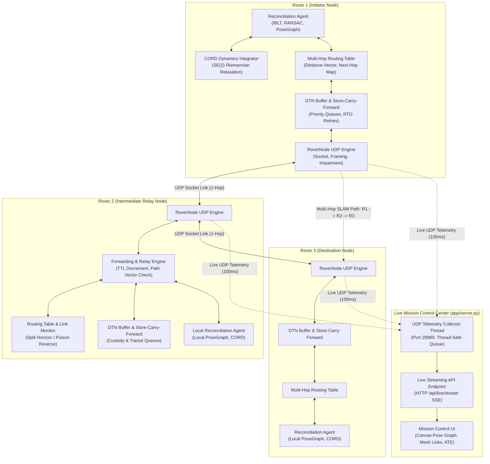
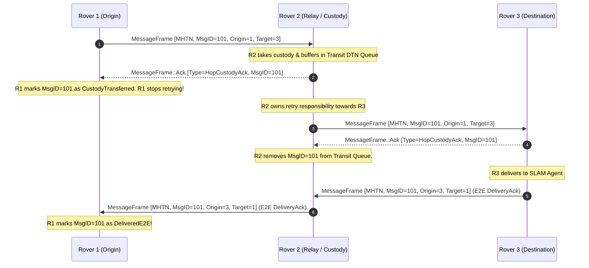
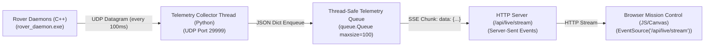

# AstroMesh-X — Milestone 7.11 Architecture Specification
## Multi-Hop Distributed SLAM Routing & Live UDP Dashboard Streaming (Final Corrected Edition)

**Document ID:** `docs/M7_11_ARCHITECTURE.md`  
**Date:** 2026-11-06 (Amended Protocol Edition)  
**Status:** PROPOSED & READY FOR IMPLEMENTATION REVIEW  
**Author:** Antigravity (AI Coding Assistant)  
**Target Environment:** Windows 11 + MSYS2 UCRT64 GCC 16.2.0 + Ninja 1.13.2 + CMake 4.4.4 (100% Software-Only)  
**Parent Milestone:** Milestone 7.10 (Multi-Keyframe Trajectory SLAM & Reconciled Metrics Audit)

---

## 1. Executive Overview & Problem Formulation

Milestones 1 through 7.10 successfully established peer-to-peer distributed SLAM over UDP sockets, DTN store-and-forward buffers, Jacobson/Karn RTO estimation, Invertible Bloom Lookup Table (IBLT) set reconciliation, Kabsch/Umeyama RANSAC geometric gating, Disjoint Set Union (DSU) graph partitioning, and continuous Riemannian dynamics (CORD) on $\mathrm{SE}(2)$.

However, all existing distributed networking operations operate strictly over **single-hop direct communication**:
1. **RF Horizon & Occlusion Inability:** If Rover 1 and Rover 3 are beyond direct communication range (or occluded by lunar crater topography), but both can reach intermediate Rover 2 ($R_1 \leftrightarrow R_2 \leftrightarrow R_3$), Rover 1 and Rover 3 cannot discover each other, cannot reconcile landmark observations, cannot close inter-rover loops, and cannot exchange boundary states.
2. **Static Dashboard Replay Limitation:** The web dashboard (`app/server.py`) currently executes batch CLI runs (`sim_runner.exe`) and serves pre-computed JSON replays. There is no live UDP telemetry listener or real-time streaming showing live pose-graph evolution, active routing paths, DTN queues, and CORD relaxation as independent rover daemons run concurrently.

Milestone 7.11 solves both challenges by introducing:
- **Autonomous Multi-Hop DTN Routing:** Distance-vector path routing with split horizon and poison reverse, hop-by-hop custody forwarding, path-vector loop prevention, bounded TTL hop limits, route sequence epoch tracking, custody ACK regeneration, and store-carry-forward buffering during transient link partitions.
- **Production Wire Protocol Purity:** All benchmark ground-truth labels are completely removed from network wire payloads; benchmark telemetry is evaluated via an out-of-band ground-truth registry.
- **Live UDP Dashboard Streaming Engine:** An asynchronous UDP telemetry collector thread in `app/server.py` streaming live rover state, multi-hop routes, pose graphs, and CORD relaxation directly to the browser UI via Server-Sent Events (SSE).

---

## 2. Multi-Hop Distributed SLAM Architecture

### 2.1 System Architecture Diagram



---

## 3. Protocol Design & Wire Representation

### 3.1 Unification under `MessageFrame`

All network communication on the wire strictly utilizes the existing, versioned **36-byte Little-Endian `MessageFrame`**:
- `[0..3]`: MAGIC `0x58545341` (`'ASTX'`)
- `[4..5]`: `schema_version` (1)
- `[6..7]`: `message_type` (`MessageType` enum)
- `[8..9]`: `sender_rover_id` (immediate hop transmitter)
- `[10..11]`: `target_rover_id` (immediate hop receiver; $0 = \text{broadcast}$)
- `[12..15]`: `sequence` (hop-local link sequence number)
- `[16..23]`: `timestamp_ns` (hop transmit timestamp)
- `[24..27]`: `payload_length`
- `[28..35]`: `checksum` (SplitMix64/FNV-1a)

No bytes are added to the 36-byte transport frame header, preserving 100% compatibility with existing frame deserializers and regression tests.

---

### 3.2 MultihopEnvelope Wire Layout (Inside `MessageFrame.payload`)

When a frame is routed across multiple hops, its payload begins with a standardized, little-endian **`MultihopEnvelope`** header.

To completely eliminate the capacity mismatch between `visited_nodes` and `MaxHops = 8`, the envelope header defines:
- `MAX_HOPS = 8`
- `MAX_PATH_LENGTH = 8`
- `uint16_t visited_nodes[8]` (16 bytes)

```
 0                   1                   2                   3
 0 1 2 3 4 5 6 7 8 9 0 1 2 3 4 5 6 7 8 9 0 1 2 3 4 5 6 7 8 9 0 1
+-+-+-+-+-+-+-+-+-+-+-+-+-+-+-+-+-+-+-+-+-+-+-+-+-+-+-+-+-+-+-+-+
|                 MAGIC ('MHTN' = 0x4E54484D)                   |
+-+-+-+-+-+-+-+-+-+-+-+-+-+-+-+-+-+-+-+-+-+-+-+-+-+-+-+-+-+-+-+-+
|    Version    |     Flags     |        Origin Rover ID        |
+-+-+-+-+-+-+-+-+-+-+-+-+-+-+-+-+-+-+-+-+-+-+-+-+-+-+-+-+-+-+-+-+
|        Final Target ID        |   Hop Count   |   Max Hops    |
+-+-+-+-+-+-+-+-+-+-+-+-+-+-+-+-+-+-+-+-+-+-+-+-+-+-+-+-+-+-+-+-+
|                       Message ID (Low 32)                     |
+-+-+-+-+-+-+-+-+-+-+-+-+-+-+-+-+-+-+-+-+-+-+-+-+-+-+-+-+-+-+-+-+
|                       Message ID (High 32)                    |
+-+-+-+-+-+-+-+-+-+-+-+-+-+-+-+-+-+-+-+-+-+-+-+-+-+-+-+-+-+-+-+-+
|  Path Length  |                   Reserved                    |
+-+-+-+-+-+-+-+-+-+-+-+-+-+-+-+-+-+-+-+-+-+-+-+-+-+-+-+-+-+-+-+-+
|         Visited Node 0        |         Visited Node 1        |
+-+-+-+-+-+-+-+-+-+-+-+-+-+-+-+-+-+-+-+-+-+-+-+-+-+-+-+-+-+-+-+-+
|         Visited Node 2        |         Visited Node 3        |
+-+-+-+-+-+-+-+-+-+-+-+-+-+-+-+-+-+-+-+-+-+-+-+-+-+-+-+-+-+-+-+-+
|         Visited Node 4        |         Visited Node 5        |
+-+-+-+-+-+-+-+-+-+-+-+-+-+-+-+-+-+-+-+-+-+-+-+-+-+-+-+-+-+-+-+-+
|         Visited Node 6        |         Visited Node 7        |
+-+-+-+-+-+-+-+-+-+-+-+-+-+-+-+-+-+-+-+-+-+-+-+-+-+-+-+-+-+-+-+-+
|                    Application Payload Bytes ...              |
+-+-+-+-+-+-+-+-+-+-+-+-+-+-+-+-+-+-+-+-+-+-+-+-+-+-+-+-+-+-+-+-+
```

#### Field Layout Specifications (40 Bytes Total Envelope Header, 64-Bit Aligned):
- **`MAGIC` (4 bytes, offset 0):** `0x4E54484D` (`'MHTN'` little-endian).
- **`Version` (1 byte, offset 4):** Protocol version (default `1`). Reject if unsupported.
- **`Flags` (1 byte, offset 5):**
  - Bit 0 (`0x01`): `CUSTODY_ACK_REQUESTED` (request hop-level custody acknowledgment).
  - Bit 1 (`0x02`): `E2E_ACK_REQUESTED` (request end-to-end delivery acknowledgment).
  - Bits 2..7: Reserved (must be 0).
- **`Origin Rover ID` (2 bytes, offset 6):** Logical creator of the message ($1 \dots 65535$).
- **`Final Target ID` (2 bytes, offset 8):** Final destination ($1 \dots 65535$, $0 = \text{broadcast}$).
- **`Hop Count` (1 byte, offset 10):** Number of intermediate edges traversed ($0 \dots 8$).
- **`Max Hops` (1 byte, offset 11):** Maximum allowed hops (default `5`, clamp ceiling `8`).
- **`Message ID` (8 bytes, offset 12):** Immutable end-to-end ID: `(origin_rover_id << 48) | monotonic_counter`.
- **`Path Length` (1 byte, offset 20):** Number of entries in `Visited Nodes` array ($1 \dots 8$).
- **`Reserved` (3 bytes, offsets 21..23):** Zero padding for 32-bit alignment.
- **`Visited Nodes` (16 bytes, offsets 24..39):** Fixed array of 8 `uint16_t` values recording the exact traversed rovers.

#### Definition of Nodes Counted:
- **Origin Node:** Counted as the first entry (`visited_nodes[0] = OriginRoverID`, `path_length = 1`).
- **Intermediate Relay Nodes:** Each relay node handling the packet appends its ID (`visited_nodes[path_length++] = relay_id`).
- **Destination Node:** Terminal receiver; delivers payload locally without needing to re-append.
- **Capacity Match Guarantee:** Since `MaxHops <= 8`, an 8-hop path traverses at most 8 sender/relay nodes (`visited_nodes[0..7]`). The 8-element array **guarantees no valid path can ever overflow the envelope**.

#### Malformed Frame Rejection Rules:
A received frame carrying `'MHTN'` is dropped immediately without crashing or memory corruption if:
1. `payload.size() < 40`.
2. `Version != 1`.
3. `HopCount > MaxHops` or `MaxHops > 8` or `MaxHops == 0`.
4. `PathLength > MaxHops` or `PathLength > 8` or `PathLength == 0`.
5. `OriginRoverID == 0`.

---

### 3.3 Scalable Path-Vector Loop Prevention

Instead of a bitmask (which limits rover IDs to fixed bit ranges), AstroMesh-X uses a **Path-Vector Trail**:
- Any valid 16-bit Rover ID ($1 \dots 65535$) is supported without constraint.
- **Loop Detection Rule:** Upon receiving a frame for forwarding, the node iterates through `visited_nodes[0 .. path_length - 1]`. If `visited_nodes[i] == self_rover_id`, the node immediately drops the frame and increments `stats.routing_loops_suppressed`.
- When forwarding, the node sets `visited_nodes[path_length++] = self_rover_id` and increments `HopCount++`.

---

### 3.4 HopCount & MaxHops Boundary Semantics

| Role / State | HopCount | MaxHops | Semantic Behavior |
|:---|:---:|:---:|:---|
| **Source Originator** | $0$ | $5$ (default, max 8) | Origin attaches envelope, sets `visited_nodes[0] = self_id`, `path_length = 1`, and enqueues. |
| **Relay Node (Target $\ne$ Self)** | $h$ | $H \le 8$ | If $h + 1 \ge H$: **TTL Expired**. Drop frame, increment `stats.ttl_expired_drops`.<br>If $h + 1 < H$: Set `HopCount = h + 1`, append `self_id`, forward to next hop. |
| **Destination Node (Target == Self)** | $h \le H$ | $H \le 8$ | Accept for local delivery regardless of hop count. Send E2E ACK to `OriginRoverID`. |
| **Boundary: MaxHops = 1** | $0$ | $1$ | Allows direct 1-hop delivery only. If received by a relay, $0 + 1 \ge 1 \implies$ dropped. |

---

### 3.5 MessageID vs. Hop-Local Sequence Numbers

1. **`MessageID` (64-Bit Global Identity):**
   - Constructed once at the origin: `(origin_rover_id << 48) | counter`.
   - **Strictly Immutable:** Stored in `MultihopEnvelope` and preserved across all retransmissions, forwarding hops, and DTN custody transfers.
   - End-to-end duplicate suppression and delivery ACKs reference `MessageID`.
2. **`sequence` (32-Bit Hop-Local Transport Number):**
   - Stored in `MessageFrame.sequence`.
   - Generated dynamically by the immediate transmitter for that physical link.
   - Hop-local sliding-window filtering (`PeerTracker::is_duplicate`) operates on `(sender_rover_id, sequence)`.

---

### 3.6 Hop-Level Custody ACK & Regeneration on Duplicate MessageID

AstroMesh-X separates link-level custody transfers from application-layer delivery:



#### Custody ACK Regeneration Specification:
- If a `HopCustodyAck(MsgID)` sent by Rover 2 back to Rover 1 is dropped or delayed over the channel, Rover 1 will retransmit `MessageFrame(MsgID)`.
- When Rover 2 receives a duplicate `MessageID`:
  1. Rover 2 inspects its custody index (`m_custody_delivered_set` or active `m_transit_queue`).
  2. Rover 2 recognizes that custody was already accepted.
  3. Rover 2 **suppresses duplicate downstream forwarding** (preventing duplicate transmissions towards Rover 3).
  4. Rover 2 **immediately regenerates and transmits `HopCustodyAck(MsgID)`** back to Rover 1.
  5. This holds identically even after Rover 3 has already delivered the message or if an End-to-End ACK was lost in transit.

---

### 3.7 Relay Crash/Restart Behavior & Queue Durability Guarantees

1. **Durability Guarantee:**
   - The AstroMesh-X DTN buffer and transit queues are **in-memory data structures** (volatile across process kill/restart). This aligns with SWaP-constrained space robotics flight software utilizing radiation-hardened volatile RAM.
2. **Crash & Restart Recovery Semantics:**
   - If an intermediate relay crashes while holding custody of a message before downstream delivery:
     - The origin node maintains an **End-to-End Delivery Timer** ($T_{\text{e2e\_timeout}} = 3 \times \text{MaxHops} \times \text{SRTT}$).
     - If the origin does not receive an End-to-End Delivery ACK within $T_{\text{e2e\_timeout}}$, custody transfer has failed. The origin re-enqueues the message with a fresh hop attempt.
     - When the relay process restarts, its clean in-memory state accepts the re-originated frame and forwards it normally.

---

### 3.8 Distance-Vector Routing (AstroMesh-DVR) & Epoch Tracking

1. **Routing Table Structure:**
   Each node maintains a table of destinations:
   $$\text{RouteEntry} = \{ \text{dest}, \text{next\_hop}, \text{metric}, \text{seq}, \text{last\_advertised\_ns}, \text{last\_refreshed\_ns} \}$$
   where $\text{metric} \in [1 \dots 15]$, with $16 = \infty$ (unreachable).
2. **Route Sequence / Epoch Tracking & Stale Advertisement Rejection:**
   - Each rover maintains an internal 32-bit `route_epoch` incremented on link state changes.
   - When Rover B receives a routing advertisement from Rover A for destination $D$:
     - If $\text{adv.seq} > \text{local.seq}$: **Fresher route**. Update route entry, adopt metric and next-hop.
     - If $\text{adv.seq} == \text{local.seq}$: Standard Bellman-Ford rule (adopt only if $\text{adv.metric} + 1 < \text{local.metric}$).
     - If $\text{adv.seq} < \text{local.seq}$: **Stale Advertisement Rejection**. Discard advertisement without updating local table.
     - Handles RFC 1982 sequence wraparound via signed integer difference: `(int32_t)(adv.seq - local.seq) > 0`.
3. **Split Horizon with Poison Reverse:**
   - When Rover 2 advertises routes to Rover 1: for any route where `next_hop == Rover 1`, Rover 2 advertises $\text{metric} = 16$ ($\infty$).
   - Completely eliminates 2-node counting-to-infinity loops ($R_1 \leftrightarrow R_2$).
4. **Route Expiration & Triggered Updates:**
   - Periodic updates every $500\,\text{ms}$. Route timeout at $1500\,\text{ms}$ sets $\text{metric} = 16$.
   - Physical link failures trigger immediate poisoned advertisements to neighbors.

---

### 3.9 Deterministic DTN Buffer Capacity Enforcement

Both local DTN outgoing queues and multi-hop transit queues enforce strict dual-constraint capacity limits:

| Parameter | Limit | Enforcement & Eviction Policy |
|:---|:---:|:---|
| **Max Frame Count** | $200$ frames | Strict limit across all priority tiers |
| **Max Memory Bytes** | $1\,\text{MB}$ ($1,048,576$ bytes) | Total sum of payload and header bytes |
| **Priority Tiers** | High, Normal, Low | High: SLAM boundary states & loop closures<br>Normal: Proposals, responses, routing updates<br>Low: Bulk telemetry & heartbeats |
| **Eviction Policy** | Low $\to$ Normal $\to$ Drop | When full: Low priority evicted first (oldest first).<br>If all frames are High priority: **Backpressure** triggered (`EnqueueResult::CapacityBytesExceeded`). High priority frames are never evicted by lower tiers. |
| **TTL Expiration** | Configured per message | Swept during `dequeue_next_eligible()`. Expired frames dropped and logged. |

---

### 3.10 Pure Production Wire Format (Ground Truth Separation)

**Safety Rule:** No benchmark ground-truth labels shall ever exist on the network wire.
- In production, `LandmarkObservationRecord` on the wire contains strictly:
  `{ key (16B), local_x (8B), local_y (8B), keyframe_index (4B) }` = 36 bytes.
- Ground truth validation for scientific benchmarking is maintained **exclusively outside the network stack** in a benchmark-side evaluation registry (`GroundTruthBenchmarkRegistry`).
- RANSAC geometric gating and loop closure acceptance evaluate **100% on coordinates and descriptor keys**. Ground truth is completely inaccessible to the verifier.

---

### 3.11 Live Telemetry Streaming Pipeline & Schema

To provide real-time visualization without compromising authoritative SLAM state:



1. **Step 1 (Rover Daemon C++):** Every $100\,\text{ms}$, `rover_daemon.exe` serializes a compact diagnostic state and broadcasts a UDP datagram to `127.0.0.1:29999` using `UdpSocket`.
2. **Step 2 (Python Telemetry Collector):** A background daemon thread in `app/server.py` listens on UDP port 29999, parses incoming JSON datagrams, updates `swarm_state[rover_id]`, and pushes updates into a thread-safe `queue.Queue`.
3. **Step 3 (HTTP SSE Streaming):** `/api/live/stream` serves an HTTP `text/event-stream`. It drains the queue and writes differential events (`data: {...}\n\n`) flushed immediately.
4. **Step 4 (Browser Rendering in `app.js`):** An `EventSource` receives events, updates the rover state table, animates 1-hop (green) and multi-hop relay (dashed blue) beams on the HTML5 Canvas, and draws live CORD relaxation curves.

---

## 4. Universal Protocol Invariants vs. Benchmark Criteria

### Universal Network Protocol Invariants
1. **Wire Framing Invariant:** Every packet transmitted over UDP has length $\ge 36$ bytes and begins with `MAGIC = 0x58545341`.
2. **Multi-Hop Envelope Invariant:** Every forwarded transit packet has payload length $\ge 40$ bytes and begins with `MAGIC = 0x4E54484D`.
3. **Loop Freedom Invariant:** For any frame $F$, $\text{visited\_nodes}[i] \ne \text{visited\_nodes}[j]$ for all $i \ne j$.
4. **Hop Bound Invariant:** $0 \le \text{HopCount} \le \text{MaxHops} \le 8$.
5. **Byte Accounting Invariant:** $\text{Total Wire Bytes} \equiv \text{Data Wire Bytes} + \text{ACK Wire Bytes} + \text{Forwarded Wire Bytes}$.
6. **Wire Purity Invariant:** Zero ground-truth flags exist in any production network payload.

### Scientific Benchmark Evaluation Criteria (Empirical Goals)
- **Target Precision:** $\ge 99.0\%$ ($FP \approx 0$ against synthetic adversarial proposals).
- **Target Recall:** $\ge 99.0\%$ on genuine proposals under nominal channel conditions.
- **Target ATE:** Sub-0.5 m trajectory error on localized closed loops; monotonic error reduction during CORD relaxation.

---

## 5. Comprehensive Test Matrix Specifications

| Test Case | Scenario / Topology | Verified Condition |
|:---|:---|:---|
| **T1: Direct Route Equivalence** | $R_1 \leftrightarrow R_2$ (1 hop) | Multi-hop engine with direct peer delivers with identical performance to single-hop baseline. |
| **T2: Linear 3-Rover SLAM Relay** | $R_1 \leftrightarrow R_2 \leftrightarrow R_3$ | $R_1$ reconciles IBLT and closes loop with $R_3$ through $R_2$. DSU unifies to 1 component. |
| **T3: Arbitrary Rover IDs** | IDs 101, 2045, 9999 | Path-vector trail verifies loop detection and delivery with arbitrary non-contiguous IDs. |
| **T4: HopCount & TTL Boundary** | $R_1 \to R_2 \to R_3$ with `MaxHops=1` | Relay $R_2$ drops frame with `ttl_expired_drops` counter increment. |
| **T5: Loop Suppression** | Cyclic 3-rover loop | Injected cyclic frame dropped immediately upon encountering visited ID. Zero loops circulated. |
| **T6: Split Horizon / Poison Reverse** | $R_1 \leftrightarrow R_2 \leftrightarrow R_3$ | Severing $R_2 \to R_3$ causes immediate poisoned advertisement ($\infty$) to $R_1$; prevents counting-to-infinity. |
| **T7: Custody ACK & Duplicate Forwarding** | Loss of custody ACK | Resent frame from $R_1$ recognized by $R_2$ via `MessageID`; duplicate delivery suppressed; ACK resent. |
| **T8: Transit Buffer Exhaustion** | 200 frames enqueued in $R_2$ | Low priority evicted first; High priority preserved; backpressure triggered when full. |
| **T9: Partition & Store-Carry-Forward** | Link $R_2 \to R_3$ blackout (2s) | Frames buffered in transit queue; flushed and delivered upon link reconnection. |
| **T10: Malformed Frame Safety** | Corrupted envelope / header | Frames with invalid magic, truncated lengths, or illegal hop counts fail cleanly without crash. |
| **T11: Pure Wire Format Verification** | Network inspection | Confirmed zero ground-truth flags present in serialized byte streams. |
| **T12: Regression Integrity** | Full repository suite | 26/26 CTest, 13/13 acceptance, and 5 historical benchmark CSVs remain 100% passing and intact. |
