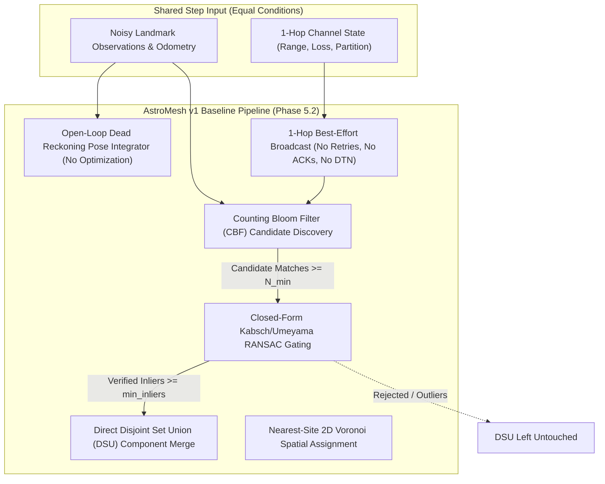

# AstroMesh v1 Baseline Pipeline Specification
## Phase 5.2 Architecture, Verification Contract, and Fair Comparison Protocols

*Date: October 28, 2026*  
*Target Revision: `main`*  
*Status: Verified by 19/19 CTest suites (100% pass)*

---

## 1. Executive Overview & Pipeline Architecture

Phase 5.2 establishes the formal reference baseline pipeline representing **AstroMesh v1**, encapsulated behind the strongly typed interface `IRoverSwarmPipeline` (`include/astromesh/simulation/pipeline_interface.hpp`).

The primary purpose of this baseline is to provide an honest, reproducible, and verifiable counterpart against which the novel features of **AstroMesh-X** (Invertible Bloom Lookup Tables, Continuous Riemannian Dynamics, delay-tolerant filtering, adaptive damping, explicit multi-hop DTN routing, and bounded keyframe pruning) can be evaluated under identical synthetic environments, trajectories, and channel realizations.

---

## 2. Component Specifications

### 2.1 Shared Pipeline Interface (`IRoverSwarmPipeline`)
Both AstroMesh v1 and AstroMesh-X conform to the pure virtual interface `IRoverSwarmPipeline`:
- `pipeline_name()`: Identifies the active architecture (`"AstroMesh_v1_Baseline"` vs `"AstroMesh_X"`).
- `ingest_step(const SimulationStepInput& step_input)`: Consumes per-rover odometry increments, landmark observations, and pairwise channel link states.
- `collect_metrics()`: Exposes a structured snapshot of discovery attempts, loop closures, component counts, logical message counts, and wire bytes.
- `get_loop_closure_history()`: Exposes all evaluated loop candidates (including failure diagnosis codes).
- `get_estimated_trajectories()` / `get_current_pose(rover_id)`: Provides estimated poses for external ATE/RPE evaluation against ground truth.
- `num_connected_components()` / `are_rovers_connected(rover_a, rover_b)`: Queries DSU topological connectivity.

### 2.2 Candidate Discovery Semantics & CBF Limitations
- **Implementation:** Reuses `astromesh::core::CountingBloomFilter` with 8-bit saturated counters and Kirsch-Mitzenmacher double-hashing.
- **Query Direction:** For active rover pair $(A, B)$, Rover $B$ queries each of its observed `LandmarkKey`s against Rover $A$'s transmitted CBF via `cbf.contains(key_b)`.
- **Candidate Semantics:** A Bloom-filter positive indicates that a key is *probably* present in the remote filter, subject to the theoretical false-positive probability $P_{FP} \approx (1 - e^{-kn/m})^k$. It does **not** prove shared physical identity and does **not** prove metric geometric consistency.
- **False Positive Handling:** If an unshared landmark produces a false positive, it is admitted to the candidate correspondence set. However, it will fail geometric verification if the synthetic correspondences cannot form a consensus rigid transform.
- **Wire Payload:** The serialized payload of a CBF exchange is $m$ bytes (where $m$ is the number of 8-bit counters), independent of the actual set difference size $d = |A \Delta B|$.

### 2.3 Geometric Verification & DSU Merge Rules
- **Implementation:** Reuses `astromesh::verification::verify_relative_pose_2d`.
- **Strict Verification Gate:** Candidate correspondences are formed exclusively from measured local sensor points (`obs.measured_local_point`). Ground-truth coordinates and poses are never leaked to the verifier.
- **DSU Merge Invariant:**
  - Components are united via `dsu_.unite(node_a, node_b)` **only** when RANSAC yields `success == true` with inlier count $\ge N_{\min}$ (default 4) and inlier ratio $\ge 50\%$.
  - Rejected candidates (`InsufficientCorrespondences`, `DegeneratePointConfiguration`, `InsufficientInliers`, `LowInlierRatio`) never mutate DSU components.
  - Idempotency is enforced: duplicate accepted events between the same keyframe pair touch zero counters and do not double-increment `dsu_merge_events`.

### 2.4 Open-Loop Pose-Estimation Assumptions
- **No Optimization:** AstroMesh v1 intentionally contains **zero pose-graph optimization** (neither continuous dynamics CORD nor centralized Levenberg-Marquardt). Poses are integrated forward via open-loop odometry composition:
  $$X_{k+1} = X_k \cdot \Delta X_k$$
- **Pose Immutability:** Loop closures merge topological components in DSU but **never backpropagate corrections** to past keyframes in the baseline.
- **Odometry Noise:** Configurable linear noise $\sigma_{\text{trans}}$ and angular noise $\sigma_{\text{rot}}$ can be injected using the pipeline's deterministic PRNG to test drift accumulation.

### 2.5 Communication Model & Wire Byte Accounting
- **1-Hop Best-Effort:** Messages are transmitted directly across single-hop links without store-and-forward queues, retransmissions, or return ACKs.
- **Channel Loss:** If a link experiences packet loss ($u \sim U(0, 1) < p_{\text{loss}}$), the transmission is dropped:
  - `logical_messages_sent` increments.
  - `logical_messages_dropped` increments.
  - Wire bytes are debited against channel budget.
  - The receiver processes zero data; no candidate matching or loop closures can occur.
- **Wire Byte Formula:**
  $$\text{Wire Bytes} = B_{\text{payload}} (m\,\text{counters}) + 24\,\text{B (protocol header)} + 16\,\text{B (framing)} = m + 40\,\text{B}$$

### 2.6 Nearest-Site Voronoi Spatial Assignment
- **Implementation:** Implemented as `NearestSiteVoronoiAssignment` (`include/astromesh/simulation/voronoi_assignment.hpp`).
- **Mathematical Rigor:** Evaluates the exact Euclidean nearest-site rule:
  $$\operatorname{site}(q) = \arg\min_{i} \|q - s_i\|_2$$
- **Tie-Breaking Rule:** If a point lies exactly on the equidistant boundary between multiple sites ($\|q - s_i\|_2 = \|q - s_j\|_2 \pm 10^{-9}\,\mathrm{m}$), the tie is broken deterministically by selecting the site with the smallest numerical `site_id`.
- **Characterization:** This component provides exact nearest-site spatial assignment. It is distinct from continuous dynamic frontier allocation, which remains out of scope for this baseline.

---

## 3. What is Intentionally Excluded from the Baseline

To ensure fair contrast with AstroMesh-X, the following components are strictly excluded from AstroMesh v1:
1. **Invertible Bloom Lookup Tables (IBLT):** Excluded; replaced by Counting Bloom Filters.
2. **Continuous Riemannian Dynamics (CORD):** Excluded; no Lie group integrator or boundary state exchange.
3. **Delay-Tolerant Network (DTN) Buffer:** Excluded; no priority queues, aging, or backoff retries.
4. **Explicit Network ACKs:** Excluded; best-effort one-way broadcast.
5. **Multi-Hop Store-Carry-Forward Routing:** Excluded; direct single-hop only.
6. **Keyframe Pruning:** Excluded; all keyframes are retained in memory indefinitely.
7. **Boundary State Filtering & Adaptive Damping:** Excluded.

---

## 4. Verification Evidence

The implementation is verified by 15 dedicated unit test suites in `tests/test_baseline_astromesh_v1.cpp`:
1. `test_construction_and_validation`: Validates config boundaries and rejection of non-finite inputs.
2. `test_deterministic_initialization`: Verifies bit-for-bit trajectory and metric identity across identical seeds.
3. `test_cbf_positive_and_verification_success`: Confirms candidate discovery and successful RANSAC closure promotion.
4. `test_cbf_rejection_on_geometric_conflict`: Proves that CBF false matches with non-rigid coordinates are rejected by geometric gating without merging DSU.
5. `test_insufficient_or_degenerate_correspondences`: Verifies safe failure on $<4$ points and collinear points.
6. `test_dsu_connectivity_transitions`: Confirms DSU transitions from 2 components to 1 component upon verified closure.
7. `test_rejected_closures_preserve_partitions`: Verifies DSU never merges for disjoint/rejected landmarks.
8. `test_idempotent_event_handling`: Verifies repeated steps do not duplicate merge events.
9. `test_open_loop_estimates`: Confirms open-loop poses drift realistically under noise and remain separate from ground truth.
10. `test_optimization_unsupported_flags`: Asserts that `optimization_supported`, `dtn_supported`, and `keyframe_pruning_supported` are strictly `false`.
11. `test_one_hop_loss_and_byte_accounting`: Verifies exact accounting of sent, delivered, dropped, and wire bytes.
12. `test_replay_determinism`: Proves complete repeatability across scenario resets.
13. `test_voronoi_spatial_assignment`: Verifies nearest-site cells, boundary equidistant ties, and numerical tie-breaking.
14. `test_edge_cases`: Verifies empty worlds, single-rover steps, and severed links.
15. `test_metrics_separation`: Asserts mathematical consistency across payload, protocol, and framing bytes.

---

## 5. Summary of Baseline Metrics & Denominators

| Metric | Type | Calculation / Denominator |
| :--- | :--- | :--- |
| `candidate_discovery_attempts` | Counter | Total pairwise CBF query attempts between rovers |
| `candidate_pairs_proposed` | Counter | Total candidate landmark pairs passing `cbf.contains()` |
| `verification_attempts` | Counter | Total candidate clusters with $\ge N_{\min}$ points evaluated by RANSAC |
| `loop_closures_verified` | Counter | Closures satisfying inlier count and residual threshold |
| `loop_closures_rejected` | Counter | Candidates failing inlier count, ratio, or covariance checks |
| `dsu_merge_events` | Counter | Discrete component union operations in DSU |
| `logical_messages_sent` | Counter | One-hop CBF transmission attempts initiated |
| `logical_messages_delivered` | Counter | Messages arriving over non-lossy channel links |
| `logical_messages_dropped` | Counter | Messages dropped due to simulated link loss |
| `total_wire_bytes_transmitted` | Bytes | $B_{\text{payload}} + B_{\text{protocol}} + B_{\text{framing}}$ across all transmissions |
